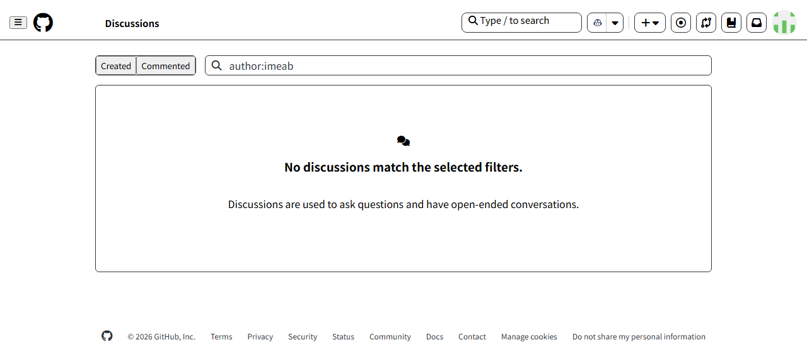
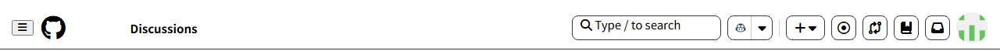
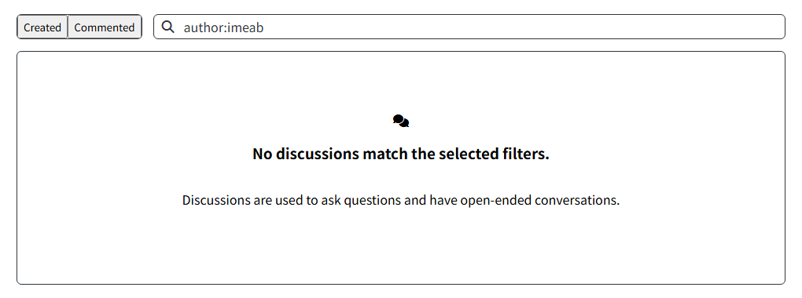
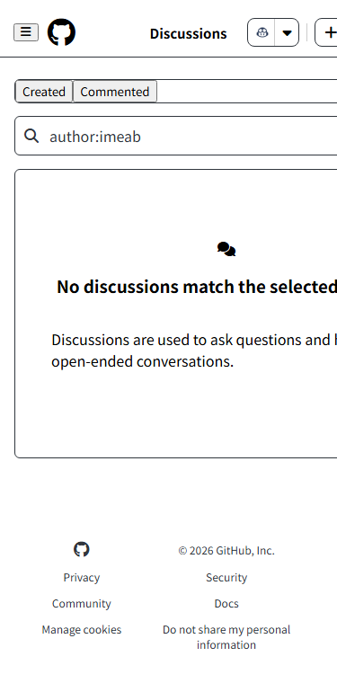

# GitHub Discussions 클론 코딩 (HTML + CSS 과제)

GitHub의 Discussions 페이지를 HTML과 CSS로 따라 만들어 봤습니다.

- 페이지 파일: [`Discussions/Discussions.html`](Discussions/Discussions.html)
- 스타일 파일: [`Discussions/css/style.css`](Discussions/css/style.css)

## 사용한 기술

- **HTML 시맨틱 태그**: `header`, `nav`, `main`, `section`, `form`, `footer`
- **접근성**: 검색창 `label`, 아이콘 버튼 `aria-label`, 이미지 `alt`
- **CSS 레이아웃**: Flexbox (헤더, 탭, 검색창), Grid (태블릿·모바일 푸터 메뉴)
- **반응형**: `@media` 브레이크포인트 768px(태블릿), 480px(모바일)

## 실행 방법

`Discussions/Discussions.html` 파일을 브라우저로 열면 됩니다.

## 화면 캡처

### 전체 화면

### 헤더

### 메인

### 푸터

### 모바일 화면 (375px)

